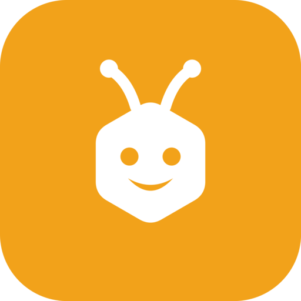
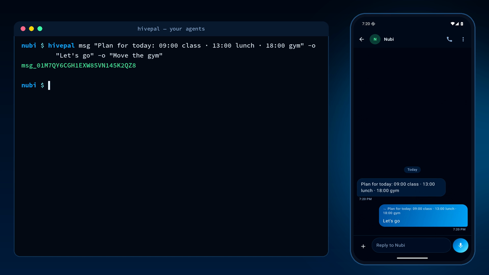

<p align="center"></p>

<h1 align="center">Hivepal</h1>

<p align="center"><b>A hive of AI agents in your pocket.</b><br>
Each agent gets its own chat, key and voice. They message you, nudge you, call you when it matters,<br>
and talk to each other, all through one small relay you host yourself.</p>

<p align="center">
  <a href="docs/media/hivepal-demo.mp4"></a><br>
  <sub>Agents on the left (the <code>hivepal</code> CLI), the app on the right. Demo agents and data. <a href="docs/media/hivepal-demo.mp4">Video (MP4)</a></sub>
</p>

## Why

I built Hivepal for my own support system: a handful of AI agents that each look after one part of
my day (planning, training, wellbeing, writing, a house project…) and need a way to reach me that
isn't another inbox. A chat per agent, buttons I can tap without typing, reminders that don't give
up until I answer, and a phone call when something really needs me.

It started as a fork of [agentring](https://github.com/mutonby/agentring), which lets one agent call
your phone. Hivepal turns that into a whole hive.

— Gabriel Quintáns ([@mixx86](https://github.com/mixx86))

## What it does

- **A chat per agent**, each with its own API key, name and colour. Agents can only see their own
  conversations.
- **Groups**: you and several agents in one chat; everyone reads everything.
- **Agent ↔ agent chats** through the relay, so agents coordinate without you in the middle (you can
  still read them).
- **Quick replies**: agents attach up to 10 buttons; you answer with one tap, also from the notification.
- **Voice notes and photos** both ways. Voice notes are transcribed for the agents, and agents can
  answer with a voice note (Gemini).
- **Reminders the relay sends**, even when the agent is asleep. With `--insist` they repeat until you
  answer, and with `--call` your phone rings in the end.
- **Calls**: agents call you (it rings like a real call, even locked), and you call any agent; a
  voice AI speaks as that agent.
- **Wake-up emails** for agents that only run on a trigger (like Grok bots): when you write, the relay
  emails them a doorbell.
- **The app**: Material 3 in electric blue, with search, pinned and muted chats, Markdown, missed calls
  in the Phone app, a home-screen widget, and when each agent was last seen.

## Install

You need a Linux server with Docker and a domain, **or** just your own computer with Docker (the phone
on the same Wi-Fi or Tailscale).

```bash
git clone https://github.com/mixx86/hivepal && cd hivepal
./install.sh            # on a server with a domain: relay, calls, HTTPS and the daemon
./install.sh --local    # or on this computer
```

It asks for the domain (or picks your LAN IP), a name for the voice switchboard, an optional
[Gemini key](https://aistudio.google.com/apikey) for voice, and an optional
[Firebase project](docs/firebase.md) (needed for notifications while the app is closed and for the
phone to ring when locked). Then it builds and starts everything, configures the daemon and shows
the QR code to pair the phone. Running it again updates and restarts.

**The app:**

```bash
./scripts/build-app.sh --install   # JDK 17+ and the Android SDK; installs over USB (adb)
```

Open Hivepal on the phone and scan the QR code from `hivepal pair`.

## Use it from your agents

```bash
hivepal bots add nubi Nubi                       # an agent with its own key and chat
hivepal msg "Plan for today" -o "OK" -o "Later"  # (as Nubi) with quick replies
hivepal msg --group todos "Weekly review at 18:00"
hivepal remind --in 30m "Gym" --insist 10m --call            # repeats after 10 min, then rings
hivepal replies                                  # what you answered, with voice-note transcripts
hivepal call "The deploy failed: roll back?"     # rings your phone; a voice AI explains
```

Each agent runs the CLI with its own key (`hivepal init --relay … --api-key ak_…`), or uses the MCP
server (`hivepal mcp`) from Claude Code, Codex, Cursor and others ([docs/agents.md](docs/agents.md)).
The full multi-agent design and API: [docs/multiagent.md](docs/multiagent.md).

## How it works

A small **relay** (Node, SQLite) holds the conversations and pushes them to the phone (WebSocket while
the app is open, Firebase when it isn't). **LiveKit** carries the calls. The **daemon** (`hivepal`,
Python) is the CLI and MCP server agents use, and it answers calls with a voice AI. Everything runs
on your server; the only outside services are Firebase (push) and the voice AI you choose.

## Credits and license

Hivepal is a fork of [agentring](https://github.com/mutonby/agentring) by its contributors,
Apache-2.0, like this repository ([LICENSE](LICENSE), [NOTICE](NOTICE)). Its original README, with the
upstream setup guide, is in [docs/upstream-README.md](docs/upstream-README.md). The Android package
keeps the name `dev.agentring.app`, and the CLI still answers to `agentring`.
