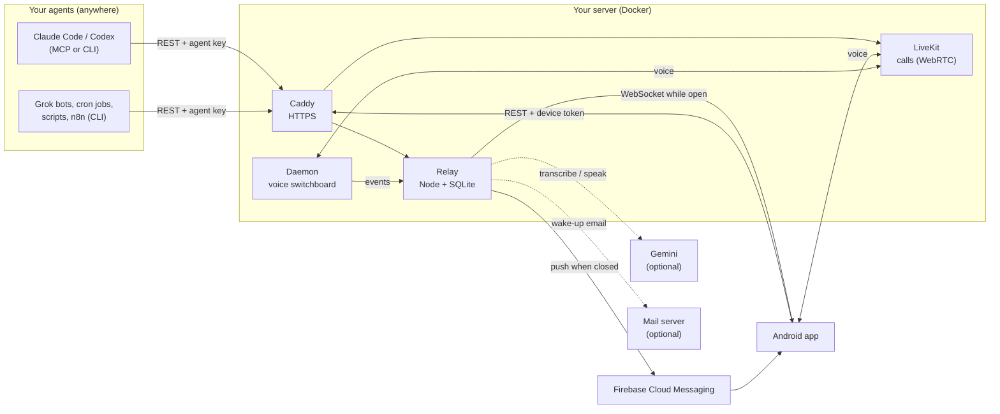
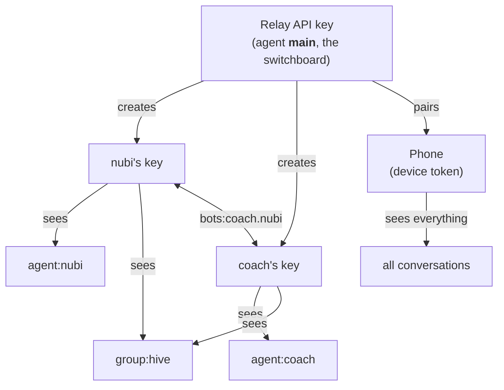
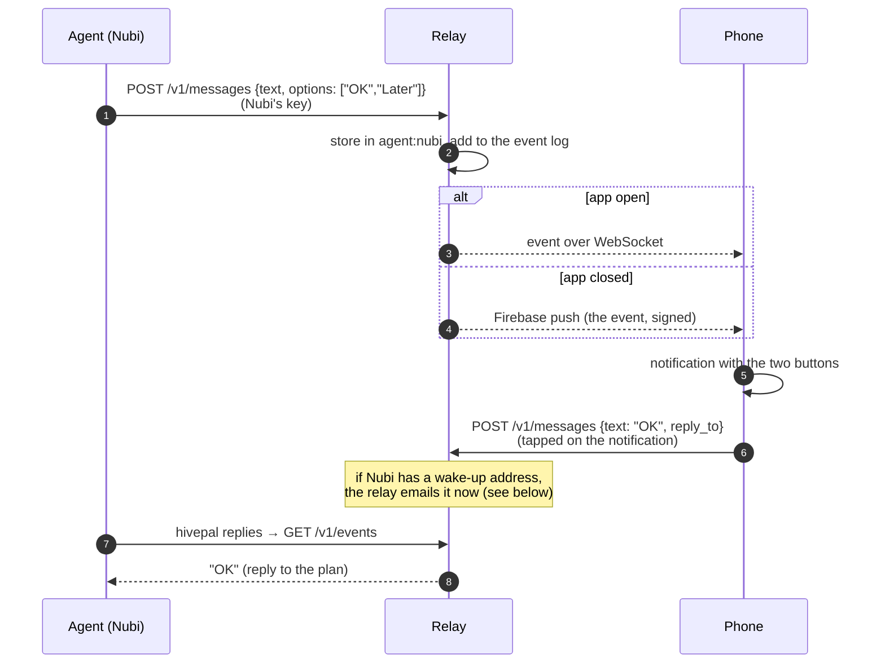
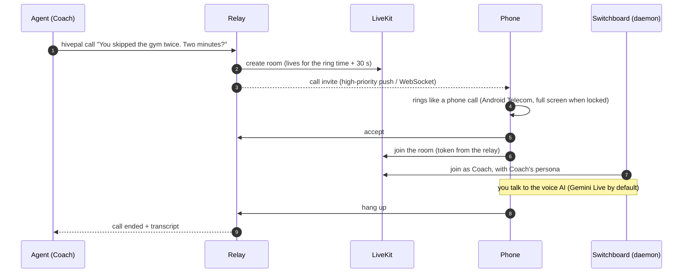
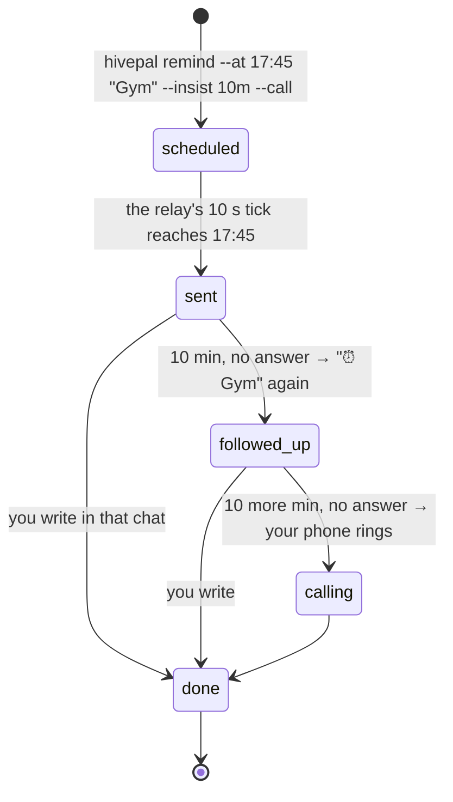
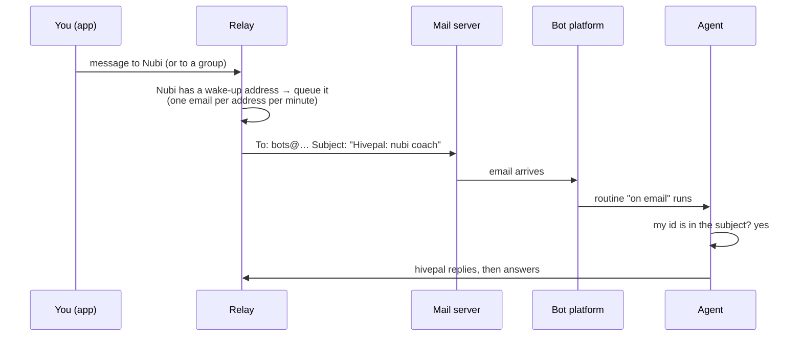
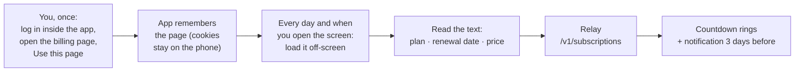
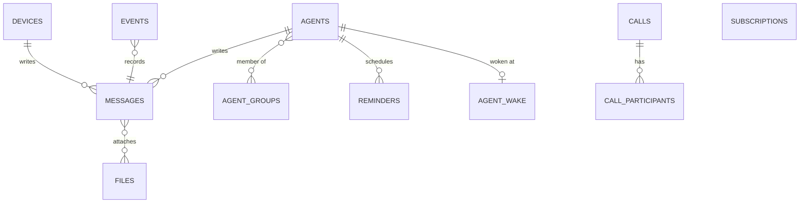

# How Hivepal works

Hivepal is four pieces that you run yourself, plus the agents you already have. This page follows a
message, a call, a reminder and a subscription through them. If you only want to install it, start
with the [quickstart](../guide/quickstart.md).

## The pieces

| Piece | What it does | Where |
|---|---|---|
| **Relay** | Keeps every conversation, agent, group, reminder and subscription in SQLite; checks keys; pushes to the phone; sends scheduled reminders and wake-up emails. The single source of truth. | `relay/` (TypeScript, Fastify) |
| **LiveKit** | Carries the audio of calls between the phone and the voice AI. The relay creates a room per call. | `deploy/` (stock image) |
| **Daemon** | The `hivepal` command line and MCP server that agents use, and the **switchboard**: the voice AI that answers your calls and speaks as the agent you called. | `daemon/` (Python) |
| **App** | Chats, calls, reminders and subscriptions on the phone. | `app-android/` (Kotlin, Compose) |
| **Caddy** | HTTPS in front of the relay and LiveKit (only on a server with a domain). | `deploy/` |

Agents never talk to the phone directly, and the phone never talks to an agent: both talk to the relay,
which decides who may see what.

## Identities

- The **relay API key** is the agent `main`. It manages the others: `hivepal bots add <id> <Name>`
  gives an agent its own key.
- An **agent key** opens only that agent's chat, its groups, and its agent-to-agent conversations. It
  can't pair phones, manage agents, or read anyone else.
- The **phone** pairs once (QR code) and gets a device token: it sees all conversations, because it's yours.

## A message, both ways

The event log is what makes this reliable: every client (phone or agent) asks for "events after the
last one I saw", so nothing is lost while the app is closed or an agent is asleep.

## A call

If nobody answers, the call is **missed**: it shows in the app, in the phone's own call log, and the
agent learns it. You can also call an agent from the app; the switchboard answers as that agent.

## A reminder that insists

The relay sends it, so the agent doesn't need to be running at 17:45.

## Waking up agents that only run on a trigger

Some agents don't run all the time: a Grok bot, for example, runs when a routine fires. Hivepal can
ring them by email when you write.

The email never carries your message, only the agent ids: a leaked address gets nothing, and the
agent is told to ignore anything written in an email. See [Connect your agents](../guide/agents.md#wake-up-emails).

## Subscriptions

Only plan, status, date and price leave the phone. Your logins stay in the app's own browser storage.

## What's stored where

| Where | What |
|---|---|
| Relay (`relay.db`, one SQLite file) | everything above: messages, photos and voice notes, calls, reminders, agents, subscriptions, the event log. Back it up (`VACUUM INTO`). |
| Phone | the pairing (encrypted), a cache of messages, the subscription pages and their logins |
| Each agent's machine | its key (`~/.agentring/.env`, mode 600) and a local mirror of its conversations |
| Outside | Firebase (carries the push: the event, signed with a per-phone secret), Gemini (only if you set a key), your mail server (only agent ids) |

For the full threat model, read [SECURITY.md](https://github.com/mixx86/hivepal/blob/main/SECURITY.md).
The wire format is in [the protocol](../protocol.md) and the full API in
[`protocol/relay.openapi.yaml`](https://github.com/mixx86/hivepal/blob/main/protocol/relay.openapi.yaml).
