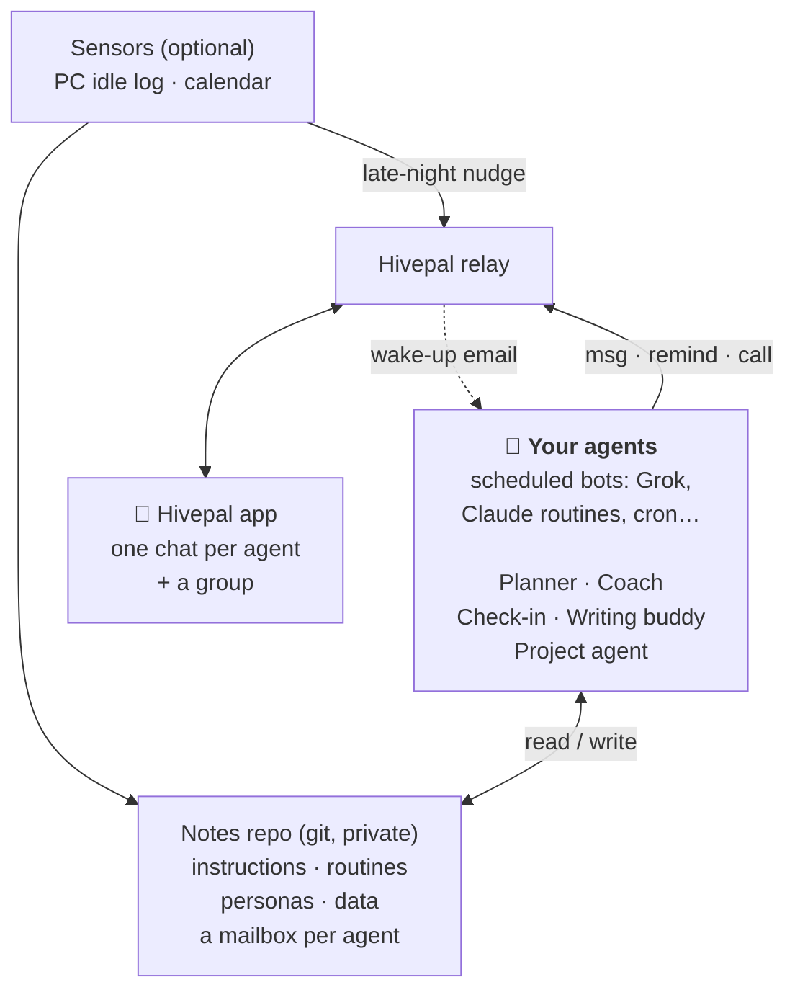

# A hive of personal agents

Hivepal was built for this: a handful of AI agents that each look after one part of your day, and
reach you in one place. This guide describes the setup it grew out of, step by step, so you can build
your own. Swap the roles for whatever you need.



## The roles

Each agent has **one job**, its own chat, and its own voice on calls. An example set:

| Agent | Its job | Typical routines |
|---|---|---|
| **Planner** | The day's plan, deadlines, coordinating the others | 07:30 plan with buttons; Sunday weekly review |
| **Coach** | Training and sleep | reminder before the gym that **insists** and finally **calls**; bedtime nudge |
| **Check-in** | Mood and energy, without fuss | morning 1–10 with buttons; notices a bad streak and says it plainly |
| **Writing buddy** | A creative project | proposes 20-minute slots; reads a chapter and gives direct feedback |
| **Project agent** | A side project (a house, a home lab…) | next small step, shopping list with prices |

They also share a **group** for things everyone must know, and talk to each other in agent-to-agent
chats (`hivepal msg --to planner …`) instead of asking you twice.

## 1. Hivepal

Install it on a server ([guide](server.md)) so the agents can reach it from the cloud, set up
Firebase (a locked phone must ring) and a Gemini key (calls and voice notes).

## 2. A private notes repo

The agents need a shared memory that you can read and edit. A private git repository works well:

```text
notes/
├── bots/
│   ├── common.md              # rules for every agent (tone, Hivepal commands, privacy)
│   └── planner/
│       ├── instructions.md    # its job, in your words
│       ├── routines.md        # what it does and when
│       └── persona.md         # how it sounds on a call
├── mailbox/planner/           # notes other agents leave for it
└── data/                      # whatever they track: plans, training log, sleep…
```

Each agent gets a token that can read and write this repo, and nothing else.

## 3. Create the agents

```bash
hivepal bots add planner Planner     # repeat per agent; keep each key
hivepal groups add everyone Everyone --members planner,coach,checkin,writing,project
```

Then create each bot on its platform with a first message along these lines:

```text
You are Planner, one of my support agents. Your job: <one or two sentences>.
1. Install the Hivepal CLI and connect with your key: hivepal init --relay https://hive.example.com --api-key <key>
2. Clone the notes repo; your folder is bots/planner/. Read bots/common.md and follow it.
3. Write your instructions and routines in your folder, in your own words, and commit them.
4. Set up your routines (see routines.md), including an hourly `hivepal replies`.
5. Send me one short message in Hivepal when you're ready.
```

## 4. Routines that work

- **Hourly**: `hivepal replies`, read your mailbox, answer. Nothing to do → do nothing.
- **Plans with buttons**: `hivepal msg "Gym at 18:00?" -o "Yes" -o "Move it"` — one tap beats typing.
- **Insist only where it matters**: `hivepal remind --at 17:45 "Gym in 15" --insist 10m --call`.
- **Wake-up emails** so an agent answers in seconds instead of within the hour:
  [how](agents.md#wake-up-emails).
- **Watch the watchers**: the Agents screen shows when each one was last seen.

## 5. Voices for calls

The switchboard (`hivepal serve --ai`) speaks as the agent you call when it finds
`personas/<agent_id>.md` in its home (`/config/personas/` in Docker). Keep personas in the notes repo
and sync them there (a cron job with `git pull` and a copy is enough).

## 6. Sensors (optional)

Small scripts on your computer can feed the hive:

- **Late nights**: log when the computer goes idle and comes back (e.g. `swayidle` on Wayland); after
  your bedtime, if you're still at it, the coach writes — and calls if you ignore it.
- **Calendar**: keep your timetable in the notes repo and generate an `.ics` your calendar app
  subscribes to, so the planner and your calendar never disagree.

## 7. Subscriptions

Connect the services you pay for in the app ([how](app.md#subscriptions)): the hive knows what renews
when, and you get a heads-up three days before.

## What to keep in mind

- **Privacy**: the agents' platform sees what you tell the agents. Keep the most personal things with
  the agents (and platforms) you trust most, and never put secrets in messages.
- **Less is more**: start with two agents and add one when a job is clearly missing. Each new agent is
  another voice asking for your attention.
- **Not a professional**: agents can nudge and listen; they don't replace people. Give the check-in
  agent a clear rule for when to suggest talking to someone.
